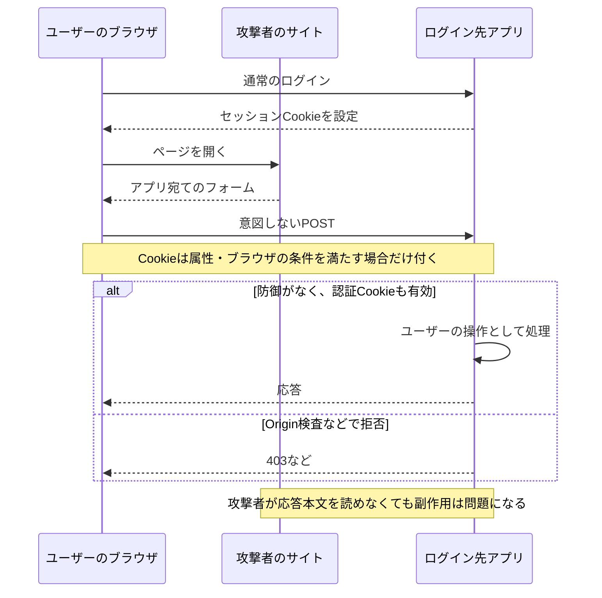
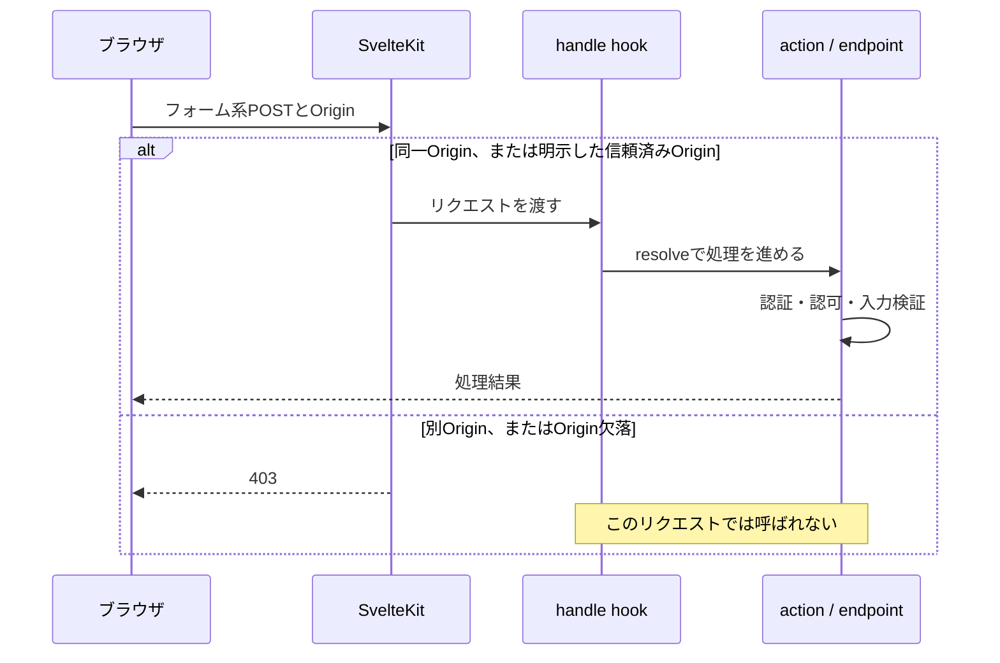
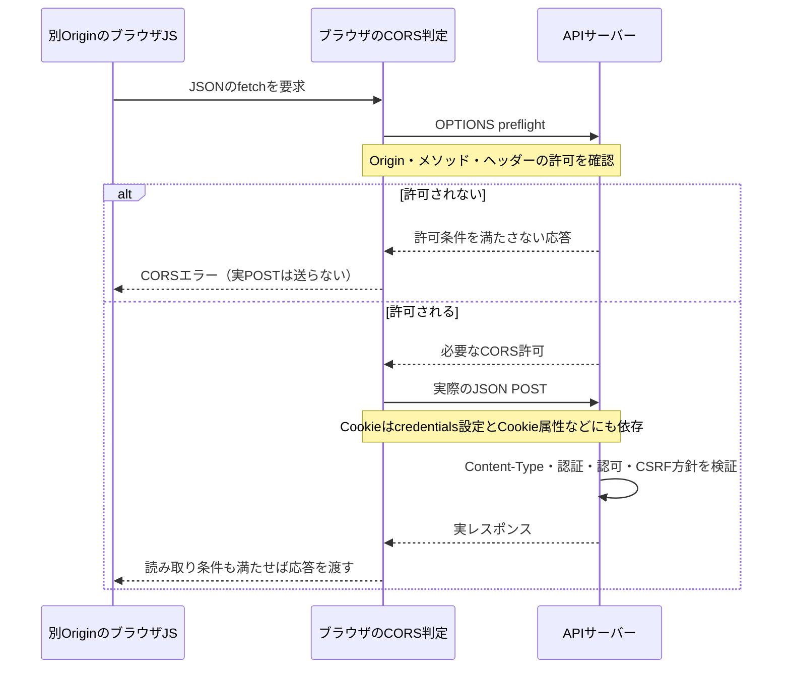

## はじめに

SvelteKitでフォームを作ると、CSRFトークンを自分で埋め込んでいなくても、別のOriginからの送信が403になることがあります。

では、SvelteKitを使っていれば、すべてのAPIについてCSRFを考えなくてよいのでしょうか。

この記事では、「どのリクエストを、どの段階で拒否するのか」を実装から整理します。先に要点をまとめると、次のようになります。

- SvelteKitには、特定の更新系リクエストに対するOrigin検査がある
- 通常のフォームとJSON APIでは、その検査の対象範囲が異なる
- Cookieの`SameSite`、CORS、認証・認可は、それぞれ別の役割を持つ
- 本番で正規のフォームが403になる場合は、検査を無効化する前にOriginの認識を確認する

:::message
本文の実装読解は、このブログのlockfileにある **SvelteKit 2.49.4** を対象にしています。Svelteは5.46.1、Viteは6.4.1です。これは既存コードの理解のための固定点であり、新規環境にこの旧バージョンを推奨するものではありません。

2026年10月19日時点の公式ドキュメントには3系の変更も含まれます。2.49.4の挙動と混ぜず、最後に差分を整理します。
:::

## 1. CSRFでは何が起きるのか

CSRF（Cross-Site Request Forgery）は、ユーザーのブラウザを経由して、ユーザーが意図していないリクエストを送らせる攻撃です。

Cookieでログイン状態を管理するアプリを考えます。ブラウザは送信先とCookieの属性などの条件を満たすと、リクエストにCookieを自動で付けます。攻撃者がセッションCookieの値を知っている必要はありません。

ただし、**別サイトからの送信なら必ずCookieが付くわけではありません**。`SameSite`、`Secure`、Domain、Path、ブラウザのポリシーなどによって変わります。



攻撃の成立には、対象のリクエストがユーザーの権限で処理され、望まない副作用が起きることが関わります。「攻撃者がレスポンスを読めるか」だけを見ていると、この点を見落とします。

また、ログインCSRFのように、既存の被害者セッションCookieだけを前提にできないケースもあります。Cookieが付いていないことだけで、すべてのCSRFが無害だとは判断できません。

## 2. SvelteとSvelteKitの担当を分ける

[SvelteKitのIntroduction](https://svelte.dev/docs/kit/introduction)では、SvelteをUIコンポーネントの仕組み、SvelteKitをルーティングやサーバー処理なども含むアプリケーションフレームワークとして説明しています。

今回見るのは、Svelteコンポーネントの機能ではなく、**SvelteKitのサーバー側の検査**です。

| 構成                            | サーバー側の防御を確認する場所        |
| ------------------------------- | ------------------------------------- |
| SvelteKitのform actions         | SvelteKitのリクエスト処理と各action   |
| SvelteKitの`+server.ts`         | SvelteKitのリクエスト処理と各endpoint |
| Svelteから別のAPIサーバーを呼ぶ | そのAPIサーバー側                     |
| 静的なSvelteの画面だけを配信    | 書き込みを受けるバックエンド側        |

画面をSvelteで書いたこと自体が、別サーバーのCSRF対策を有効にするわけではありません。

## 3. 2.49.4のOrigin検査を読む

入口は、固定タグの[`respond.js`](https://github.com/sveltejs/kit/blob/@sveltejs/kit@2.49.4/packages/kit/src/runtime/server/respond.js)です。通常のリクエストについて、次の条件がすべて揃うと403を返します。

1. 開発モードではない
2. 通常リクエスト用のCSRF検査が有効
3. `Content-Type`がフォーム系として扱われる
4. メソッドが`POST`、`PUT`、`PATCH`、`DELETE`のいずれか
5. リクエストの`Origin`が、サーバー側の`url.origin`と一致しない
6. `Origin`が信頼済みOriginにも含まれていない

概念的には、次のような判定です。これは説明用の疑似コードであり、独自ミドルウェアとしてコピーするための実装ではありません。

```text
本番相当の処理
  かつ 通常のCSRF検査が有効
  かつ フォーム系Content-Type
  かつ 更新系メソッド
  かつ Originが同一でない
  かつ Originが信頼済みでもない
    → 403
```

ここでは、Cookieの有無、ログイン済みか、実際にデータを書き換えるかまでは判断していません。認証処理に入る前のリクエスト検査です。

### 対象となるContent-Type

2.49.4では、次の4種類をフォーム系として扱います。

- `application/x-www-form-urlencoded`
- `multipart/form-data`
- `text/plain`
- `application/x-sveltekit-formdata`（SvelteKit内部用）

根拠は[`form-utils.js`](https://github.com/sveltejs/kit/blob/@sveltejs/kit@2.49.4/packages/kit/src/runtime/form-utils.js)と[`utils/http.js`](https://github.com/sveltejs/kit/blob/@sveltejs/kit@2.49.4/packages/kit/src/utils/http.js)です。メディアタイプは`;`より前を取り出し、空白を除いて小文字化して比較されます。`text/plain; charset=UTF-8`や`Text/Plain`も対象です。

### actionより前、handle hookより前に拒否する



図は、本番相当・通常リクエスト・既定の検査が有効という前提です。Cookie認証を使う場合、`handle`でセッションを読み、actionやendpointで対象リソースへの権限を確かめる、といった処理は別途必要です。

また、この検査はform actions専用ではありません。条件に一致する`+server.ts`へのリクエストも対象になります。拒否は`handle`より前なので、`hooks.server.ts`で後からこの403を取り消す設計にはできません。

### 既定値とtrustedOrigins

2.49.4の[設定の既定値](https://github.com/sveltejs/kit/blob/@sveltejs/kit@2.49.4/packages/kit/src/core/config/options.js)は、`checkOrigin: true`、`trustedOrigins: []`です。通常の同一Originフォームのために、追加設定をする必要はありません。

正当な別Originからのフォーム送信が必要な場合、2系では次のように具体的なOriginを列挙します。

```js
// svelte.config.js（SvelteKit 2系）
const config = {
  kit: {
    csrf: {
      trustedOrigins: ['https://forms.example.com']
    }
  }
};

export default config;
```

実際の設定では、既存のadapterなどを残して`csrf`だけを追加します。Originはスキーム・ホスト・ポートからなり、URLのパスは含めません。この設定はルートごとの許可ではなく、アプリ全体に関わる信頼設定です。CORS設定や送信者の認証を兼ねるものでもありません。

:::message alert
`checkOrigin: false`や`trustedOrigins: ['*']`を、403を消すための一般的な対処にはしません。

2.49.4の[`write_server.js`](https://github.com/sveltejs/kit/blob/@sveltejs/kit@2.49.4/packages/kit/src/core/sync/write_server.js)では、`'*'`があると通常リクエスト用の検査自体が無効になります。この場合、Originが欠落していてもその検査では拒否されません。
:::

### remote functionsは別の分岐

2.49.4のremote functionsには、通常フォームの判定とは別のOrigin検査があります。本番相当の処理で、GET以外かつ同一Originでなければ、Content-Typeにかかわらず拒否します。

通常フォーム向けの`trustedOrigins`や`checkOrigin: false`で、この別の検査が解除されるわけではありません。以下の表と再現例は、remote functionsではなく通常の`+server.ts`を対象にします。

## 4. リクエストごとの判定表

次の表は、**2.49.4・本番相当・通常endpoint**（原則として既定設定。信頼済みOriginの行だけは明示設定）についてのソース読解から得られる判定です。「通過」は、そのCSRF検査では拒否されないという意味であり、最終レスポンスの成功を保証しません。

| メソッド             | Content-Type                        | Origin                 | 通常のCSRF検査             |
| -------------------- | ----------------------------------- | ---------------------- | -------------------------- |
| POST                 | `application/x-www-form-urlencoded` | 同一                   | 通過                       |
| POST                 | `application/x-www-form-urlencoded` | 別                     | 403                        |
| POST                 | `multipart/form-data`               | 別                     | 403                        |
| POST                 | `text/plain`                        | 別                     | 403                        |
| PUT / PATCH / DELETE | `text/plain`                        | 別                     | 403                        |
| POST                 | `application/x-www-form-urlencoded` | 欠落                   | 403                        |
| POST                 | `application/x-www-form-urlencoded` | 明示した信頼済みOrigin | 通過                       |
| POST                 | `application/json`                  | 別                     | このフォーム系検査の対象外 |
| POST                 | ヘッダー欠落                        | 別                     | このフォーム系検査の対象外 |
| GET                  | なし                                | 別                     | この更新系検査の対象外     |

GETで状態変更を行わないことも重要です。GETはリンクや画像などからも発生するため、書き込み処理をGETに移して403を回避してはいけません。

なお、form actionsはフォーム形式を要求します。JSONをactionへ送って415になることと、CSRF検査で403になることは別です。Content-Typeによる境界を調べる場合は、[`actions.js`](https://github.com/sveltejs/kit/blob/@sveltejs/kit@2.49.4/packages/kit/src/runtime/server/page/actions.js)の形式チェックが混ざらない`+server.ts`を使います。

## 5. 副作用のないローカル検証

実サービスの更新APIを使わず、204だけを返す診断用endpointで確認します。認証Cookie、データベース、外部サービスは不要です。

```ts
// src/routes/csrf-probe/+server.ts
export const POST = () => new Response(null, { status: 204 });
export const PUT = POST;
export const PATCH = POST;
export const DELETE = POST;
```

同一Originのフォームは、たとえば次のように書けます。

```svelte
<!-- src/routes/+page.svelte -->
<form method="POST" action="/csrf-probe">
  <button>診断用POSTを送る</button>
</form>
```

2.49.4では開発モードの検査が無効なので、`vite dev`の結果を本番の結果として扱わないようにします。既存のローカル検証プロジェクトで本番ビルドを作り、previewをループバックアドレスに限定して起動します。adapterやビルド設定に応じて、通常のビルド手順を使ってください。

```sh
pnpm exec vite build
pnpm exec vite preview --host 127.0.0.1 --port 4173 --strictPort
```

次のコマンドはローカルの診断用endpointだけに送ります。`curl`でOriginを明示し、サーバー側の判定を切り分けます。

```sh
# 同一Origin + フォーム形式: 期待値204
curl -i http://127.0.0.1:4173/csrf-probe \
  -H 'Origin: http://127.0.0.1:4173' \
  --data 'message=hello'

# 別Origin + フォーム形式: 期待値403
curl -i http://127.0.0.1:4173/csrf-probe \
  -H 'Origin: http://127.0.0.1:4174' \
  --data 'message=hello'

# Origin欠落 + フォーム形式: 期待値403
curl -i http://127.0.0.1:4173/csrf-probe \
  --data 'message=hello'

# 別Origin + JSON: 2.49.4のこのendpointでは期待値204
curl -i http://127.0.0.1:4173/csrf-probe \
  -H 'Origin: http://127.0.0.1:4174' \
  -H 'Content-Type: application/json' \
  --data '{"message":"hello"}'

# 別Origin + Content-Type欠落: 2.49.4では期待値204
curl -i http://127.0.0.1:4173/csrf-probe \
  -H 'Origin: http://127.0.0.1:4174' \
  -H 'Content-Type:' \
  --data 'hello'
```

`curl --data`は通常Content-Typeを自動設定するため、欠落を調べる最後の例では明示的に空にしています。

ここで204になっても、ログインや権限を確認したことにはなりません。このendpointはどのデータも保存せず、到達したら204を返すだけです。

また、`curl`はブラウザと違いOriginを自由に指定でき、CORS・Cookie・SameSiteの制約を再現しません。別ポートのローカルURLはcross-originですがsame-siteであり、この実験だけでSameSiteの挙動を検証したとはいえません。診断用コードは検証後に削除し、本番へ公開しないようにします。

### 検証範囲

執筆時には、ブログ本体と分離した最小アプリでSvelteKit 2.49.4を実行し、本番ビルド＋previewと開発サーバーのHTTP応答を確認しました。検証環境はSvelte 5.45.2、Vite 7.2.2、Svelte Vite plugin 6.2.1、Node.js 24.19.0で、ブログ本体の依存関係をそのまま再現したものではありません。

既定設定では、5メソッド×4種類のOrigin×6種類のContent-Typeを本番・開発それぞれ120件確認しました。本番は48件が403、72件が204、開発はすべて204でした。信頼済みOriginの完全一致とワイルドカードの計10件を加え、250件が実装からの期待値と一致しました。

これは実際のフレームワークを通したHTTP検証です。一方、ブラウザのCookie送信、CORS preflight、SameSite、実際のadapterやプロキシ環境はこの検証には含めていません。

## 6. SameSiteとCORSはどこを守るのか

### SameSiteはCookieの送信条件

2.49.4の[`cookies` APIの既定値](https://github.com/sveltejs/kit/blob/@sveltejs/kit@2.49.4/packages/kit/src/runtime/server/cookie.js)は、`httpOnly: true`、`sameSite: 'lax'`、原則`secure: true`です。`http://localhost`にはSecureの例外があります。

これはSvelteKitのcookies APIを使う場合の既定値です。別の認証ライブラリやサービスが発行したCookieに、自動で同じ設定が付くわけではありません。

- `HttpOnly`はJavaScriptからのCookie読み取りを制限する。自動送信は止めない
- `Secure`は原則HTTPSでだけ送るための属性
- `SameSite`はサイトをまたぐ状況でCookieを送る条件を制御する

**same-siteとsame-originは同じ判定ではありません。** たとえば同じスキームの`app.example.com`と`other.example.com`は通常same-siteですが、Originは異なります。兄弟サブドメインを信頼できるかも考える必要があります。

`SameSite=Lax`は多くのcross-site POSTで防御になりますが、トップレベルの安全なメソッドによる遷移などには例外があります。設定省略時のブラウザ挙動と明示的なLaxの違いもあるため、SameSiteだけを唯一の防御にしない方がよいです。

### CORSは送信と読み取りを分けて考える

ブラウザは、通常のHTMLフォームの送信や、CORSでいう単純なリクエストについて、必ずしも送信前の許可確認をしません。レスポンスをJavaScriptから読めなくても、サーバーで副作用が起きる可能性があります。

一方、cross-originの`fetch`で`Content-Type: application/json`を付けると、通常はpreflightが発生します。ブラウザがその許可を確認してから、実際のPOSTを送ります。



図は一般的なcross-originのJSON fetchです。preflightのキャッシュなどは省略しています。仕様上の条件は[Fetch StandardのCORS protocol](https://fetch.spec.whatwg.org/#http-cors-protocol)と[safelisted request header](https://fetch.spec.whatwg.org/#cors-safelisted-request-header)を参照してください。

## 7. JSON APIでアプリ側に残ること

「SvelteKitがJSONをこの検査で拒否しない」からといって、そのAPIが直ちに脆弱という意味ではありません。ただし、JSONという名前だけで安全だと判断することもできません。

Cookie認証のJSON APIでは、少なくとも次を確認します。

1. 受け付けるContent-Typeを明確にし、不要なフォーム形式や`text/plain`、ヘッダー欠落を拒否する
2. `request.json()`で読めたことだけを、Content-Typeを検証したことにしない
3. credential付きCORSを許可するOriginを厳密に限定する
4. セッションの有効性と、対象データを操作する権限をサーバー側で確かめる
5. 必要に応じて、明示的なOrigin検証やCSRFトークンを設計する

CSRFトークンを採用する場合も、セッションとの結び付けや検証方式が重要です。値をCookieと本文に置くだけの独自実装を安易に追加するより、信頼できる仕組みと[OWASPのCSRF Prevention Cheat Sheet](https://cheatsheetseries.owasp.org/cheatsheets/Cross-Site_Request_Forgery_Prevention_Cheat_Sheet.html)に沿って設計します。

また、ブラウザが自動で付けるCookieと、JavaScriptが明示的に付けるBearer tokenでは、脅威の前提が変わります。APIの認証方式を確認したうえで防御を選びます。どちらもXSSやトークン漏えいまで解決するものではありません。

## 8. 本番だけ403になるときの確認順

同一Originのつもりで送ったフォームが、本番環境だけで拒否される場合があります。リバースプロキシなどを挟み、ブラウザが見ているURLとサーバーが認識するURLがずれているケースです。

確認するのは、次の3点です。

1. ブラウザが送った`Origin`
2. サーバー側が認識した`url.origin`
3. 公開URLのスキーム・ホスト・ポート

CookieやAuthorizationの値、本文に含まれる個人情報までログに出す必要はありません。CSRFで拒否されたリクエストは`handle`に到達しないため、ブラウザのNetwork、adapter・プロキシの設定、安全な診断用リクエストを組み合わせて確認します。

SvelteKit 2.49.4のadapter-nodeでは、たとえば公開Originを次のように指定できます。

```sh
# 2系adapter-nodeの例。実際の公開URLに合わせる
ORIGIN=https://app.example.com node build
```

プロキシからのヘッダーを使う構成には、`PROTOCOL_HEADER`や`HOST_HEADER`などの設定もあります。ただし、外部クライアントが偽装した転送ヘッダーをそのまま信頼してはいけません。信頼できるプロキシが値を上書きし、そのプロキシを通る経路に限定されていることが前提です。

詳しくは[2.49.4のadapter-nodeドキュメント](https://github.com/sveltejs/kit/blob/@sveltejs/kit@2.49.4/documentation/docs/25-build-and-deploy/40-adapter-node.md)を参照してください。Cloudflareなど別adapterに、Node用の環境変数をそのまま当てはめないようにします。

Originの認識違いを、`trustedOrigins: ['*']`や検査の無効化で隠してしまわないことが大切です。

## 9. 3系との違いと、古い解説を読むときの注意

2026年10月19日時点では、[SvelteKit 3.1.0のリリース](https://github.com/sveltejs/kit/releases/tag/@sveltejs%2Fkit@3.1.0)と[3系への移行ガイド](https://svelte.dev/docs/kit/migrating-to-sveltekit-3)を確認できます。本文の2.49.4と特に混ざりやすい点は次です。

| 項目                     | 本文の2.49.4              | 3系の変更                                 |
| ------------------------ | ------------------------- | ----------------------------------------- |
| `csrf.checkOrigin`       | 存在するが非推奨          | 削除                                      |
| Content-Type欠落         | 通常フォーム検査の対象外  | 更新系のcross-origin検査の対象            |
| 設定の場所               | `svelte.config.js`の`kit` | `vite.config`の`sveltekit(...)`オプション |
| adapter-nodeの公開Origin | `ORIGIN`環境変数          | `paths.origin`へ移行                      |

3.1.0の判定は[`csrf.js`](https://github.com/sveltejs/kit/blob/@sveltejs/kit@3.1.0/packages/kit/src/runtime/server/csrf.js)にあります。Content-Type欠落を追加で対象にしていますが、通常のJSON APIについては、引き続きアプリ側の方針を確認する必要があります。

また、`trustedOrigins`は2.36.0で追加され、`checkOrigin`は2.36.2で非推奨化されました。2.36.4では開発モードの検査が無効化されています。古い記事の設定やdevでの結果を、異なるバージョンへそのまま一般化しないようにします。

過去には、[`text/plain`や更新メソッドの扱い](https://github.com/sveltejs/kit/security/advisories/GHSA-5p75-vc5g-8rv2)、[Content-Typeの大文字・小文字の扱い](https://github.com/sveltejs/kit/security/advisories/GHSA-gv7g-x59x-wf8f)に関する修正もありました。短いOriginチェックを自作して固定するより、利用バージョンの実装とセキュリティ更新を継続して確認することが重要です。

## まとめ

SvelteKit 2.49.4の通常のCSRF検査は、フォーム系Content-Typeと更新系メソッドを対象に、Originをactionやendpointより前で確認します。

そこから先は、アプリの構成に合わせて確認します。

- 同一Originのフォームでは、既定の防御を保つ
- JSON APIでは、受け付ける形式・CORS・認証・認可・CSRF方針を揃える
- CookieのSameSiteを多層防御として使い、same-originとの違いを意識する
- 本番403は、公開Originとサーバーの認識から調べる
- バージョンを固定して挙動を読み、新しい環境には最新の修正を適用する

「SvelteKitが守る入口」と「アプリが判断する権限」を分けると、デフォルトに任せられる部分と、自分で設計する部分が見えやすくなります。
